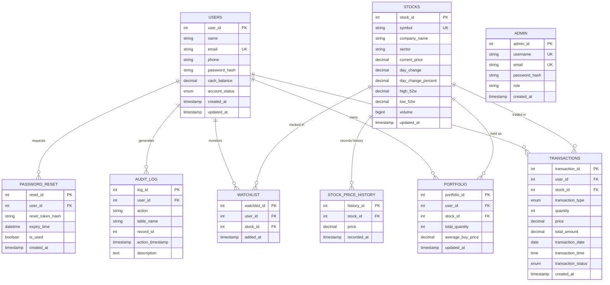

# Entity-Relationship (ER) Diagram
## Stock Market Portfolio Management System

This document outlines the conceptual and logical database design for the Stock Market Portfolio Management System.

### Mermaid ER Diagram

### Entity Descriptions and Cardinality Relationships

1. **USERS to TRANSACTIONS (1 : N)**
   - **Cardinality**: One User can execute zero, one, or many Transactions ($1 : N$).
   - **Participation**: Optional on Users side (a newly registered user has 0 transactions), Mandatory on Transactions side (every transaction must belong to exactly one user).
   - **Referential Action**: `ON DELETE RESTRICT` to preserve immutable financial audit logs.

2. **STOCKS to TRANSACTIONS (1 : N)**
   - **Cardinality**: One Stock can appear in multiple Transactions ($1 : N$).
   - **Participation**: Mandatory on Transactions side (every transaction must reference a valid stock).
   - **Referential Action**: `ON DELETE RESTRICT` to maintain transaction records.

3. **USERS to STOCKS through PORTFOLIO (M : N)**
   - **Cardinality**: Many Users can own Many Stocks ($M : N$).
   - **Resolution**: Resolved through associative junction entity `PORTFOLIO` with composite uniqueness `(user_id, stock_id)`.
   - **Attributes**: `total_quantity`, `average_buy_price`, `updated_at`.

4. **USERS to STOCKS through WATCHLIST (M : N)**
   - **Cardinality**: Many Users can monitor Many Stocks ($M : N$).
   - **Resolution**: Resolved through associative junction entity `WATCHLIST` with composite uniqueness `(user_id, stock_id)`.

5. **STOCKS to STOCK_PRICE_HISTORY (1 : N)**
   - **Cardinality**: One Stock has many historical price records ($1 : N$).
   - **Referential Action**: `ON DELETE CASCADE` so deleting a stock cleans up historical ticks.

6. **USERS to AUDIT_LOG (1 : N)**
   - **Cardinality**: One User can generate multiple audit entries ($1 : N$).
   - **Referential Action**: `ON DELETE SET NULL` to preserve security audit history even if user profile is purged.
